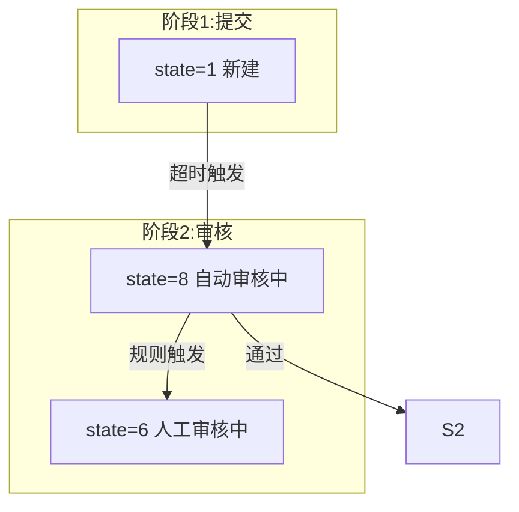

# 业务现状调研报告编写规范

本skill定义调研报告的**写什么**和**怎么写**——标准框架、内容规范、标注体系、可视化要求。是 `business-domain-familiarization` 步骤1（初稿生成）和步骤3（可视化生成）的执行依据。

## 报告定位

现状报告的核心价值：
1. **区分事实与推测**：🟢代码跑着的 / 🟡文档说的没验证 / 🚫不知道的 / ⚠️互相矛盾的——四种状态严格区分
2. **暴露问题而非粉饰**：缺口、冲突、代码缺陷、技术债要明确列出，不藏在段落里
3. **可追溯**：每个事实都能回溯到代码行/文档章节/截图，读者可自行验证
4. **可行动**：读完知道下一步该问谁、看什么代码、做什么决策

**不是**写给别人看的漂亮文档——是写给需要真实了解系统的人用的工作文档。

## 标准框架（前置元信息 + 8个业务模块，不可增减）

### 前置模块：📄 文档元信息（必须放在报告最开头）
必须包含以下内容：
| 字段 | 要求 |
|------|------|
| 文档标题 | 统一格式：`计费中台-{领域名称}业务现状调研报告V{版本号}` |
| 领域名称 | 明确所属业务域，如"发票域"、"支付域"、"订单域" |
| 文档版本 | 标注版本号 + 版本说明，如"V1.0（文档初稿 · 基于ONES文档梳理，待代码验证）"、"V3.0（最终版 · 代码+访谈全验证）" |
| 最后更新时间 | YYYY-MM-DD格式 |
| 核心负责人 | 产品/研发/业务对接人姓名（已知则填，未知标注"待补充"） |
| 关联索引 | 关联文档链接：全局术语表、访谈提纲、关联领域文档等 |
| 可信度标注规则 | 统一说明🟢/🟡/🔴/🚫/⚠️五种状态标签的含义，和本规范保持一致 |
| 版本关键改进记录 | 每个版本相对于前一版本的核心改进点，如"代码验证完成"、"访谈信息补充"、"缺陷新增"等 |

### 模块1：领域基础认知

| 子节 | 内容 | 要求 |
|------|------|------|
| 领域定位 | 一句话说清楚做什么、服务谁 | 1-2段即可，不写废话 |
| 权责边界 | ✅本域负责 / ❌本域不负责 | 从代码验证，不要从组织架构推测。边界不清是中后台最大的坑 |
| 演进时间线 | 版本→上线时间→核心改动 | 标注每条的验证状态（🟢/🟡） |

### 模块2：系统架构与核心流程（技术含量最高的模块）

必须包含以下子节：

**2.1 涉及服务与职责表**：

| 服务名称 | 职责 | 关键文件 |
|----------|------|----------|

每个服务职责写具体行为（如"定时任务XX每分钟扫state=1超时5分钟的发票10条→发事件"），不写空话。

**2.2 事件/调用架构图**：用文字或Mermaid画清楚入口（HTTP/timer/MQ）→handler→logic→backend→外部依赖的完整链路。特别标注：
- 是事件驱动还是定时轮询（直接决定时效）
- 处理速率上限（批次大小×频率=实际吞吐）
- 灰度开关机制和当前状态

**2.3 核心状态机**：这是业务流程的骨架，详见下方"状态机绘制规范"。

**2.4-2.N 各阶段业务规则**：按业务阶段（如审核阶段/开票阶段/退票阶段）逐条列出规则，每条标注代码位置。

**技术细节子节**：集成点（第三方API/Redis/MQ）、重试策略、超时配置、异常处理、文件存储、分布式锁等。

**定时任务汇总表**：

| 任务 | 所属服务 | 调度频率 | 批次限制 | 灰度控制 | 功能 | 代码位置 |

### 模块3：控制台/用户端能力现状（按实体组织）

⚠️ **V2.0→V3.0的核心教训：必须按实体组织，不要按功能点散列！**

错误写法：功能点1：敏感词校验；功能点2：金额校验……（读者看不出属于哪块）

正确写法：从用户能在系统中管理的"东西"（业务实体）出发组织：
- 实体一：XX管理 → 新增/查看/修改/删除/设默认/特殊操作……
- 实体二：XX管理 → 操作列表……
- 实体N：后台管理（如果有）

每个操作用表格列出：
| 操作 | 功能说明 | 适用范围/规则 | 验证状态 |

### 模块4：功能权限矩阵

按 **实体操作 × 角色** 组织：

| 实体/模块 | 操作 | 角色A | 角色B | 系统自动 | 验证状态 |
|-----------|------|:-----:|:-----:|:--------:|----------|

要点：
- 行是实体+具体操作（CRUD级别），不是笼统的功能点
- 列必须包含「系统自动」——很多关键操作是定时任务/事件驱动自动完成的，容易遗漏
- ✅=有权限 ❌=无权限 —=不涉及
- 不要把角色粒度拆太细（除非系统有明确的RBAC权限配置），通常2-3个角色+系统自动即可

### 模块5：业务规则清单（按归属实体/阶段分类）

⚠️ **V2.0→V3.0的核心教训：每条规则必须标注归属哪个实体/功能点！**

规则分组方式：按业务阶段或实体类型分大组（如A开票阶段/B审核阶段/C开票阶段/D敏感词/E实名/F第三方/G退票/H物流），组内编号A1/A2/B1/B2。

每条规则字段：
| 序号 | 规则 | 归属实体/功能 | 规则类型 | 验证状态 | 代码/来源位置 |

规则颗粒度：**一条 if 分支 = 一条规则**。不要把多个判断合并成含糊描述。

规则类型示例：前端校验、后端校验、审核拦截、开票拦截、异常处理、状态流转、环境控制。

### 模块6：数据模型

内容：
- **ER图**（Mermaid erDiagram）：核心表及关系，基于model结构体/SQL推导
- **字段说明表**：关键字段语义、枚举值、**单位**（金额一律标"分"）
- **核心数据口径表**：金额计算规则、阈值、时间窗口
- **字段语义坑**：明确标注字段名与实际语义不符的情况（如account_id实际存top_organization_id）

### 模块7：技术实现现状

内容：
- **核心链路依赖表**：

| 依赖系统 | 用途 | 异常处理 | 验证状态 |

- **硬编码配置项清单**：所有需改代码才能调整的配置（阈值/超时/批次/名单/端口）。这是运维痛点清单。

| 配置项 | 当前值 | 代码位置 |

- **已知代码级问题清单**：

| 序号 | 问题 | 严重程度 | 代码位置 |

代码级问题类型包括但不限于：
- 代码行为不一致（如蓝票红票走不同路径）
- 安全/校验漏洞（如后端不校验敏感词）
- 死代码（注释掉但未删除的逻辑、被屏蔽的函数）
- 代码缺陷（如for循环内return导致批量只处理第一条）
- 注释错误、错误码复用、命名歧义、硬编码
- 环境间行为不一致

### 模块8：已知问题与缺口

内容：
- **关键业务指标**：驳回率/时效/自动化率（标注数据来源和统计时间）
- **功能缺口清单**：

| 序号 | 缺口内容 | 影响 |

- **待确认/冲突清单汇总表**（这是后续访谈的核心输入）：

| 序号 | 类型 | 内容 | 来源A | 来源B | 需要核实方 |

- **规划中功能清单**：

| 功能 | PRD来源 | 当前状态 |

## 状态标注体系（全文强制）

每一段、每一张表、每一条规则都必须有状态标签。不允许出现无标签的"裸文本"。

| 标签 | 含义 | 使用要求 |
|------|------|---------|
| 🟢 现网 | 有代码实现佐证，或文档明确标注已上线且与代码一致 | 必须标注代码位置（文件名:行号） |
| 🟡 仅文档描述 | 文档写明但无代码佐证，或代码与文档不一致 | 标注文档来源，说明为什么找不到代码 |
| 🔴 规划中 | PRD/roadmap中提到，尚未上线 | 标注PRD编号/来源链接 |
| 🚫 缺口 | 文档未提及、代码未找到，或逻辑链路断裂 | 说明在哪些位置搜索过未找到 |
| ⚠️ 冲突 | 不同来源描述不一致 | 列出所有来源的说法和位置，不做裁决 |

## 可视化规范

### 状态机绘制规范

⚠️ **V2.0→V3.0的核心教训：状态机要按业务阶段线性排列，不要画成网状！**

错误示例：所有状态排成一圈，互相画线，读者看不出主流程。

正确做法：
1. 用 `subgraph` 按业务阶段分区（如：阶段1提交→阶段2审核→阶段3开票→阶段4交付→阶段5退票）
2. 主流程从上到下/从左到右线性排列
3. 流转线上**标注触发条件**（不只是画线）
4. 死状态（代码定义但不会流转到的状态）用⚠️标注
5. 异常/终态用虚线或不同样式区分
6. 附上状态常量对照表（状态值/常量名/含义/所属阶段）

Mermaid模板示例：

### ER图规范
- 使用Mermaid erDiagram语法
- 关键字段必须标注中文含义和特殊说明（如单位是"分"、字段名有歧义等）
- 不追求完整字段，列出核心业务字段即可（索引字段、审计字段如create_time/update_time可以省略）

### 表格规范
- 能用表格就不用散文段落
- 表格必须有表头
- 代码位置统一用 `文件名:行号` 格式
- 金额：代码中以分为单位的值先写精确分值，括号内折合人民币元/万元

## 写作风格

1. **用表格，不用散文**：规则、权限、依赖、配置、问题——全部表格化
2. **代码位置精确到行**：`invoice_review.go:223`，不是"在审核逻辑里"
3. **金额双标注**：`20,000,000分（20万元）`，避免单位歧义（曾踩坑：2000万分≠2000万元，差100倍）
4. **主动标记"我不知道"**：找不到就写🚫缺口，不要含糊其辞，不要用"应该""可能""大概"
5. **不做价值判断**：只陈述"代码怎么写的、行为是什么、有什么后果"。不写"这个设计不好"。改进建议是另一份文档的事
6. **修正记录要诚实**：末尾附版本修正记录，前版哪里错了就写哪里错了

## 版本修正记录

报告末尾必须附：

| 版本 | 修正项 | 原值（错误） | 实际值（代码验证） |

这让后来者清楚之前的版本哪里有问题、为什么错、如何被纠正。尤其要记录跨版本的勘误（如金额阈值差100倍这类重大错误）。

## 常见写作陷阱（来自V1.0→V3.0实际踩坑）

1. **按功能点散列而非按实体组织**（V2.0问题）：读者不知道功能属于哪个业务对象。→解决：始终从实体出发
2. **规则不标注归属**（V2.0问题）：读者不知道规则在哪个环节触发。→解决：每条规则必须有"归属实体/功能"列
3. **状态机画成蜘蛛网**（V2.0问题）：所有状态互相连线，看不出主流程。→解决：按阶段线性排列，subgraph分区
4. **文档和代码事实混为一谈**：不标注状态标签，读者分不清哪些是已验证的事实。→解决：🟢🟡🔴🚫⚠️打满
5. **只写"有什么"不写"没有什么"**：系统没做的校验/检查才是最危险的。→解决：专门检查"应该有但找不到"的逻辑，写入缺口清单
6. **金额单位错误**：把"分"当"元"导致数值差100倍。→解决：所有金额同时标注分和元
7. **把死代码当活逻辑**：被注释的代码、被灰度开关关掉的代码当成现网功能。→解决：检查调用处是否真正被执行
8. **注释当事实**：注释描述的是旧版本逻辑或根本写错了（如proto.go字段注释"0-电子；1-电子"实际0=纸质）。→解决：以代码实际逻辑为准，注释只作为参考
9. **字段名望文生义**：account_id字段实际存的是top_organization_id。→解决：追踪数据流向确认字段实际语义
10. **假设对称路径行为一致**：蓝字发票UFile上传被注释，红字却是活跃的。→解决：每条路径独立验证，不假设对称
11. **忽略定时任务频率和批次大小**：这些"非功能参数"决定了系统实际吞吐（10条/分钟 vs 事件驱动是本质差异）。→解决：定时任务表必须包含频率和批次限制
12. **错误码复用/注释错误等小问题不屑于记录**：这些小问题往往是日常debug的坑。→解决：只要发现就列入代码问题清单

## 质量自检清单

初稿生成后逐项检查：

- [ ] 前置文档元信息模块是否完整，包含领域名称/版本/更新时间/负责人/关联索引/标注规则/版本改进记录？
- [ ] 8个业务模块是否齐全，无增减？
- [ ] 每个模块/表格/规则是否都有状态标签？
- [ ] 规则是否按实体/阶段组织，每条有归属？
- [ ] 状态机是否按阶段线性排列，流转线都有条件标注？
- [ ] 权限矩阵是否包含"系统自动"列？
- [ ] 金额是否统一标注了"分"和折合人民币？
- [ ] 代码位置是否精确到文件名:行号？
- [ ] 是否有裸文本段落（无标签的陈述段落）？
- [ ] "没有"的事情（后端缺失校验/检查）是否已记录？
- [ ] 缺口清单是否记录了"在哪些位置搜索过未找到"？
- [ ] 冲突清单是否列出了所有来源不做裁决？
- [ ] 死代码/被注释代码是否标注而非当作活逻辑？
- [ ] 版本修正记录是否完整？
